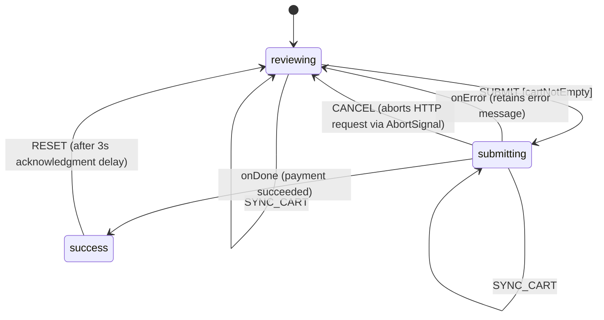
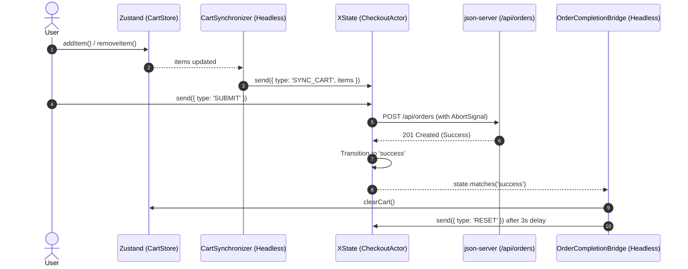

# ShopCart — Enterprise Checkout Workflow (Deliverable 4)

ShopCart is a modern shopping cart web application built with **React 19**, **TypeScript**, **Zustand 5**, and **XState v5**.

Deliverable 4 models checkout as a coordinated, multi-step workflow spanning separate, non-parent-child branches of the application. It decouples the core checkout workflow into an **XState finite state machine**, integrates a sibling **PaymentPanel**, deconstructs **CartDrawer** into granular leaf subscribers, and coordinates state between Zustand and XState using **headless bridge components**.

---

## Architecture & Component Hierarchy

```text
App
├── CheckoutActorContext.Provider (shared XState actor)
│   ├── CartSynchronizer          (headless store-to-machine sync)
│   ├── OrderCompletionBridge     (headless machine-to-store clear)
│   ├── Header
│   │   └── Toolbar
│   │       └── CartBadge
│   ├── Catalog
│   │   └── ProductCard
│   ├── CartDrawer
│   │   ├── CartItemsList         (subscribes to machine context.items)
│   │   ├── CartErrorBanner       [NEW] (subscribes to machine context.error)
│   │   └── CheckoutButton        [NEW] (subscribes to machine transition capabilities)
│   └── PaymentPanel              [NEW] (sibling panel sharing the checkout actor)
```

---

## State Machine Architecture (`checkoutMachine`)

The checkout process is modeled as an XState v5 state machine with explicit qualitative states, guards, and promise actor invocations:



### Key Machine Features

1. **Qualitative States**:
   - `reviewing`: Cart items are being reviewed. Accepts `SYNC_CART` and `SUBMIT`.
   - `submitting`: Payment submission in flight via invoked promise actor `processPayment`.
   - `success`: Terminal order completion state.

2. **Enforced Guards**:
   - `cartNotEmpty`: Evaluates `context.items.length > 0`. Prevents submission if the cart is empty.

3. **Declarative UI Querying (`can`)**:
   - `CheckoutButton` and `PaymentPanel` query `state.can({ type: 'SUBMIT' })` to toggle disabled states. This eliminates hardcoded business validation in JSX.

4. **Promise Actor with Native `AbortSignal`**:
   - `processPayment` executes an asynchronous `POST /api/orders` request with the items and total.
   - Accepts the runtime `signal: AbortSignal`.
   - Exiting `submitting` via `CANCEL` terminates the actor, immediately triggering signal abortion. The request displays as `(canceled)` in DevTools Network tab.

5. **Error Resilience**:
   - Server or network errors transition the machine back to `reviewing` while retaining the error in `context.error` for display.

---

## Bidirectional Zustand ↔ Machine Synchronization

State responsibilities are cleanly decoupled: Zustand owns global catalog and cart inventory collections, while XState owns the checkout process lifecycle.



- **Store → Machine (`CartSynchronizer`)**:
  - Headless bridge listening to Zustand cart item changes.
  - Automatically dispatches `SYNC_CART` into the running actor so the machine always processes the latest items.
- **Machine → Store (`OrderCompletionBridge`)**:
  - Headless bridge listening to the machine entering the `success` state.
  - Automatically invokes `clearCart()` in Zustand without embedding store mutations inside machine definitions.
  - Resets the machine back to `reviewing` after a 3-second display window.

---

## Granular Component Subscriptions

To optimize rendering and avoid container re-renders during state transitions:

- **`CartDrawer`**: Pure layout shell with no direct subscriptions to checkout status or errors.
- **`CartItemsList`**: Subscribes specifically to `state.context.items` via `CheckoutActorContext.useSelector`.
- **`CartErrorBanner`**: Subscribes exclusively to `state.context.error`. Renders alert messages only when an error occurs.
- **`CheckoutButton`**: Subscribes to `state.can({ type: 'SUBMIT' })` and `state.matches('submitting')`.
- **`PaymentPanel`**: Rendered as a direct sibling to `CartDrawer` in `App.tsx`, sharing the single actor via `CheckoutActorContext`. Provides payment status indicators, "Submit Payment", and mid-flight "Cancel" controls.

---

## Tech Stack

- **Framework**: [React 19](https://react.dev/)
- **Language**: [TypeScript](https://www.typescriptlang.org/)
- **Build Tool / Dev Server**: [Vite 8](https://vitejs.dev/)
- **State Machine**: [XState v5](https://stately.ai/docs/xstate) (`xstate` & `@xstate/react`)
- **State Management**: [Zustand 5](https://github.com/pmndrs/zustand)
- **Mock REST API**: `json-server@0.17.4`
- **Styling**: Semantic CSS

---

## Project Structure

```text
shop-cart/
├── db.json                               # Mock database (products & persisted orders)
├── vite.config.ts                        # Vite config with API proxy
├── package.json                          # Dependencies & run scripts
├── src/
│   ├── types/
│   │   └── index.ts                      # Shared types (Product, CartItem, CheckoutResult)
│   ├── machines/
│   │   ├── checkoutMachine.ts            # XState v5 checkout finite state machine
│   │   └── CheckoutActorContext.tsx      # Shared actor context (createActorContext)
│   ├── store/
│   │   └── CartStore.tsx                 # Modular Zustand store (Cart, Product, UI slices)
│   ├── components/
│   │   ├── CartSynchronizer.tsx          # [NEW] Headless store-to-machine synchronizer
│   │   ├── OrderCompletionBridge.tsx     # [NEW] Headless machine-to-store completion handler
│   │   ├── PaymentPanel.tsx              # [NEW] Sibling payment panel with cancel trigger
│   │   ├── CartErrorBanner.tsx           # [NEW] Leaf error display component
│   │   ├── CheckoutButton.tsx            # [NEW] Leaf declarative checkout trigger
│   │   ├── CartDrawer.tsx                # Slide-over cart drawer container
│   │   ├── CartItemsList.tsx             # Line items subscriber
│   │   ├── CartBadge.tsx                 # Header cart badge counter
│   │   ├── Catalog.tsx                   # Product catalog grid
│   │   ├── ProductCard.tsx               # Product card
│   │   ├── Header.tsx                    # Site header wrapper
│   │   └── Toolbar.tsx                   # Top navigation toolbar
│   ├── App.tsx                           # Root app with actor provider & sibling panels
│   ├── App.css                           # Application styling
│   └── main.tsx                          # Application entry point
```

---

## Getting Started

### 1. Install Dependencies

```bash
npm install
```

### 2. Run the Application

Run the mock API server and the Vite dev server in separate terminal windows:

**Terminal 1 — Mock API Server:**
```bash
npm run server
```
*Runs on `http://localhost:3001` with a 1500ms simulated latency.*

**Terminal 2 — Vite Dev Server:**
```bash
npm run dev
```
*Runs frontend on `http://localhost:5173`.*

---

## Verification & Manual Testing

1. **Declarative Empty Cart Guard**:
   - Ensure the cart is empty.
   - Verify both the "Checkout" button in `CartDrawer` and "Submit Payment" in `PaymentPanel` are disabled via `state.can({ type: 'SUBMIT' })`.
2. **Mid-Flight Cancellation (`AbortSignal`)**:
   - Add items to the cart.
   - Click "Submit Payment" or "Checkout".
   - Immediately click "Cancel" in `PaymentPanel` while the request is in flight.
   - Inspect the **Network** tab in DevTools: verify `POST /api/orders` displays status `(canceled)`.
   - Verify the UI returns to the `reviewing` state with cart items intact.
3. **Successful Order Flow**:
   - Add items to the cart and click "Submit Payment".
   - Allow the 1500ms request to complete.
   - Observe the success confirmation in `PaymentPanel`.
   - Verify `OrderCompletionBridge` clears the active Zustand cart and resets the machine back to `reviewing` after 3 seconds.
4. **Error Handling**:
   - Stop the `json-server` process (or simulate a network failure).
   - Attempt checkout.
   - Verify the machine transitions back to `reviewing` while retaining the error message, displayed cleanly in `CartErrorBanner` and `PaymentPanel`.
5. **Type Check & Production Build**:
   ```bash
   npm run build
   ```
